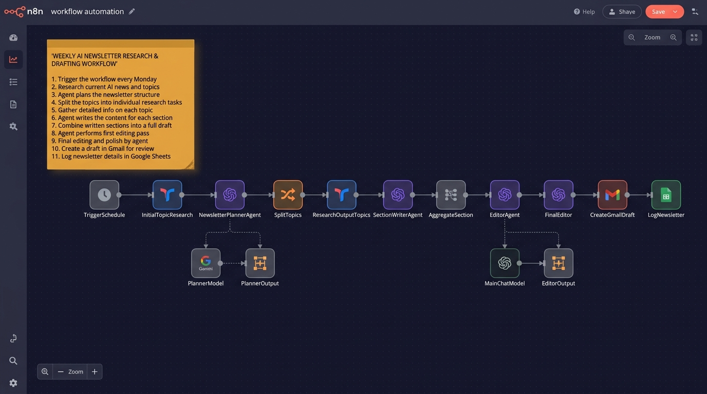
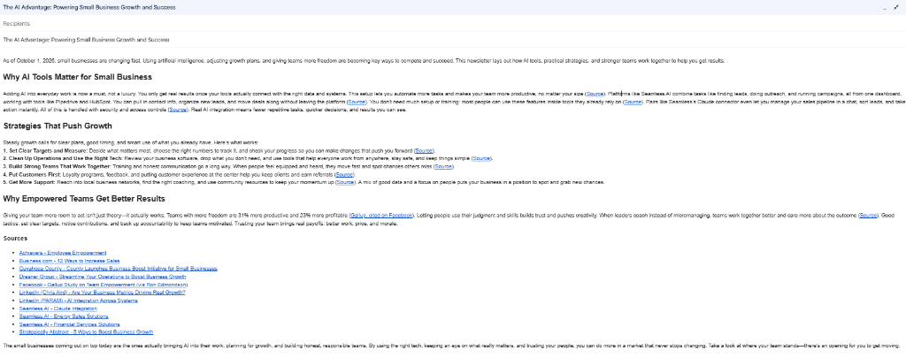

# 📰 Project 03 — Weekly AI Newsletter Automation

[](https://n8n.io)
[](https://openai.com)
[](https://ai.google.dev)
[](https://gmail.com)
[](https://sheets.google.com)
[](https://tavily.com)

---

## 📋 Overview

| Field | Details |
|---|---|
| **Industry** | Content Marketing / Media / Personal Branding |
| **Complexity** | ⭐⭐⭐⭐ Advanced |
| **Status** | ✅ Production-ready |
| **Schedule** | Every Monday at 05:00 |
| **Time Saved** | ~10 hours/week of research & writing |
| **Output** | HTML email draft + Google Sheets run log |

---

## 🧩 The Problem

Publishing a consistent, high-quality newsletter takes hours every week — researching the latest news, selecting topics, writing sections, editing for tone, formatting HTML, and sending a draft. Most newsletter creators either burn out, publish irregularly, or sacrifice quality for speed.

---

## 💡 The Solution

A fully automated weekly newsletter pipeline that runs every Monday morning without any manual input. It researches the latest AI automation news, plans a three-topic newsletter structure, writes each section, edits the full draft for human voice, creates a Gmail draft, and logs the full run to Google Sheets — all before you wake up.

---

## 🏗️ Architecture

```
┌──────────────────────────────────────────────────────────────┐
│              Schedule Trigger (Monday 05:00)                  │
└──────────────────────────┬───────────────────────────────────┘
                           ▼
┌──────────────────────────────────────────────────────────────┐
│           Initial Topic Research (Tavily)                     │
│        Fetches 3 AI automation articles from past week        │
└──────────────────────────┬───────────────────────────────────┘
                           ▼
┌──────────────────────────────────────────────────────────────┐
│         Newsletter Planner Agent (Gemini)                     │
│    Outputs: 1 newsletter title + 3 focused topics             │
└──────────────────────────┬───────────────────────────────────┘
                           ▼
┌──────────────────────────────────────────────────────────────┐
│     Split Topics → Research Each (Tavily, 1-month window)     │
└──────────────────────────┬───────────────────────────────────┘
                           ▼
┌──────────────────────────────────────────────────────────────┐
│         Section Writer Agent (GPT-4.1)                        │
│   Writes one standalone newsletter section per topic          │
└──────────────────────────┬───────────────────────────────────┘
                           ▼
┌──────────────────────────────────────────────────────────────┐
│         Aggregate Sections → Editor Agent (GPT-4.1)           │
│   Merges 3 sections into cohesive HTML with citations         │
└──────────────────────────┬───────────────────────────────────┘
                           ▼
┌──────────────────────────────────────────────────────────────┐
│              Final Editor Agent (GPT-4.1)                     │
│   Anti-AI voice pass — rewrites for natural human tone        │
└──────────────────────────┬───────────────────────────────────┘
                           ▼
             ┌─────────────┴──────────────┐
             ▼                            ▼
┌────────────────────┐       ┌────────────────────────────┐
│  Create Gmail Draft│       │  Log Run to Google Sheets  │
│  (HTML email body) │       │  (URLs, titles, timestamp) │
└────────────────────┘       └────────────────────────────┘
```

---

## 🖼️ Workflow Screenshot



> *Full workflow canvas showing all nodes: from Schedule Trigger → Tavily Research → Gemini Planner → Split Topics → Per-Topic Research → Section Writer → Aggregate → Editor → Final Editor → Gmail Draft → Google Sheets Log.*

---

## 📧 Gmail Draft Output



> *Real Gmail draft created by the workflow — a fully written, HTML-formatted newsletter ready to review and send, generated automatically every Monday morning.*

---

## ✨ Key Features

| Feature | Description |
|---|---|
| 🔍 **Automated Research** | Tavily fetches real, current AI automation news — no manual curation |
| 🧠 **AI Planning Agent** | Gemini reviews articles and structures a coherent 3-topic newsletter |
| ✍️ **Per-Topic Section Writing** | GPT-4.1 writes each section independently, grounded in fresh research |
| 🔗 **Citation-Rich Editing** | Editor agent adds inline and consolidated source citations in HTML |
| 🗣️ **Anti-AI Voice Pass** | Final editor rewrites the draft to sound like a real human wrote it |
| 📧 **Auto Gmail Draft** | Email draft created and ready to review — no copy-pasting needed |
| 📊 **Run Logging** | Every run is logged to Google Sheets with all source URLs and metadata |

---

## 🔄 Workflow Flow

```
TriggerSchedule
  → InitialTopicResearch (Tavily)
  → NewsletterPlannerAgent (Gemini + Structured Output)
  → SplitTopics
  → ResearchOutputTopics (Tavily, per topic)
  → SectionWriterAgent (GPT-4.1)
  → AggregateSection
  → EditorAgent (GPT-4.1)
  → FinalEditor (GPT-4.1, anti-AI pass)
  → CreateGmailDraft
  → LogNewsletter (Google Sheets)
```

---

## 🛠️ Tools & Integrations

- **n8n** — Workflow orchestration
- **Tavily** — Real-time web research (news + topic search)
- **Google Gemini** — Newsletter planning & structured topic output
- **OpenAI GPT-4.1** — Section writing, editing, and final voice pass
- **Gmail** — Auto-creates the newsletter draft
- **Google Sheets** — Logs every run with URLs, titles, and status

---

## 📦 Files in This Folder

```
03-weekly-ai-newsletter-automation/
├── README.md                                      ← You are here
├── workflow/
│   └── weekly_ai_newsletter_automation.json       ← Import into n8n
└── screenshots/
    ├── workflow_overview.jpg                      ← n8n workflow canvas
    └── gmail_draft_output.png                     ← Sample Gmail draft output
```

---

## ⚙️ Setup & Configuration

Before running this workflow, replace the following placeholders in the JSON:

| Placeholder | Replace With |
|---|---|
| `YOUR_EMAIL` | Your Gmail address for the draft recipient |
| `YOUR_GMAIL_WEBHOOK_ID` | Your Gmail OAuth webhook ID |
| `YOUR_SHEET_ID` | Your Google Sheet document ID |
| `YOUR_SHEET_GID` | Your target sheet GID |
| `YOUR_SHEET_URL` | Your Google Sheet URL |

**Credentials required:**
- Tavily API key
- Google Gemini API key
- OpenAI API key
- Gmail OAuth2
- Google Sheets OAuth2

---

## 📈 Detailed Business Impact & Quantitative Metrics

- ⏰ **Time Saved:** Eliminates **8–10 hours/week** of manual newsletter research, writing, and editing.
- 📉 **Consistency:** Publishes on a fixed Monday schedule with zero missed weeks — no burnout, no gaps.
- 💰 **Cost Savings:** Replaces freelance writer or agency costs; full research-to-draft in under 5 minutes.
- ⚡ **Speed:** Entire pipeline — from news fetch to Gmail draft — completes in **under 5 minutes**.
- 🗣️ **Quality:** Anti-AI voice pass ensures the output reads like a real person wrote it, not a chatbot.

---

## 👨‍💻 Author & Contact

Built with precision by **Blessing Ekpenyong** — AI Automation Specialist  
- 💼 **LinkedIn:** [Blessing Ekpenyong](https://www.linkedin.com/in/blessingekpenyong/)  
- 💬 **Open for Opportunities:** AI Automation · Workflow Engineering · Enterprise Agent Architecture
