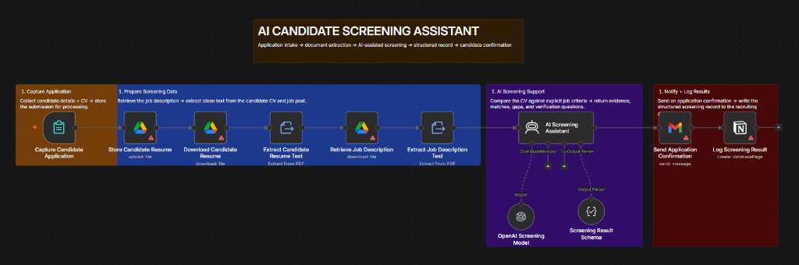
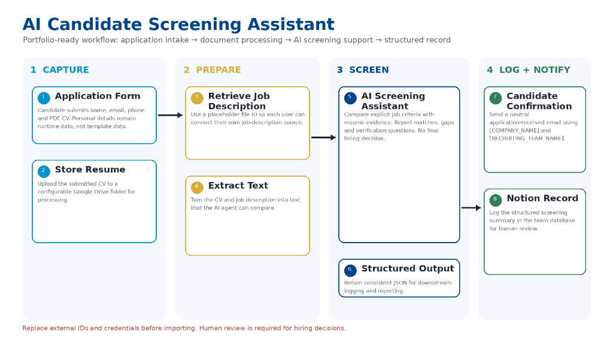
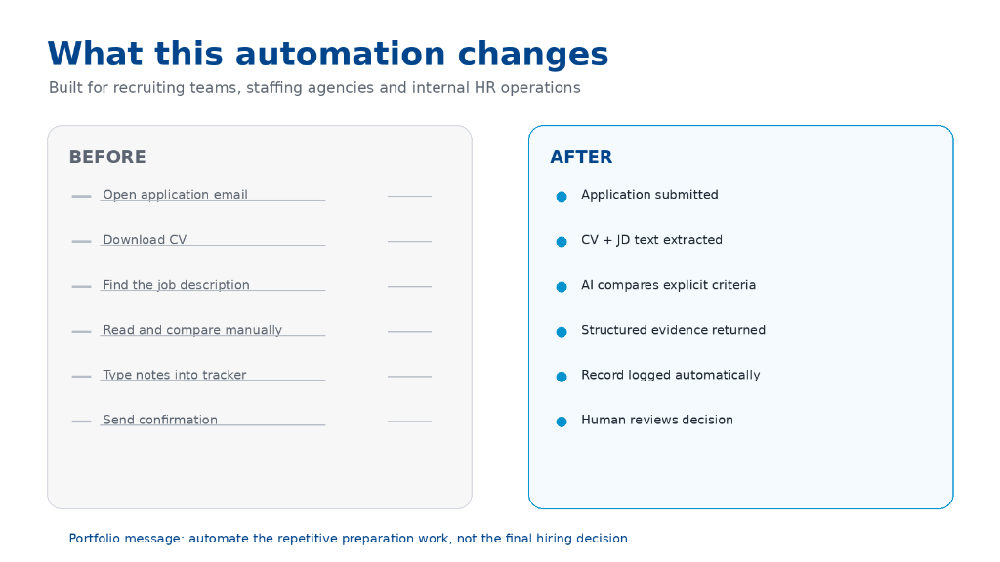
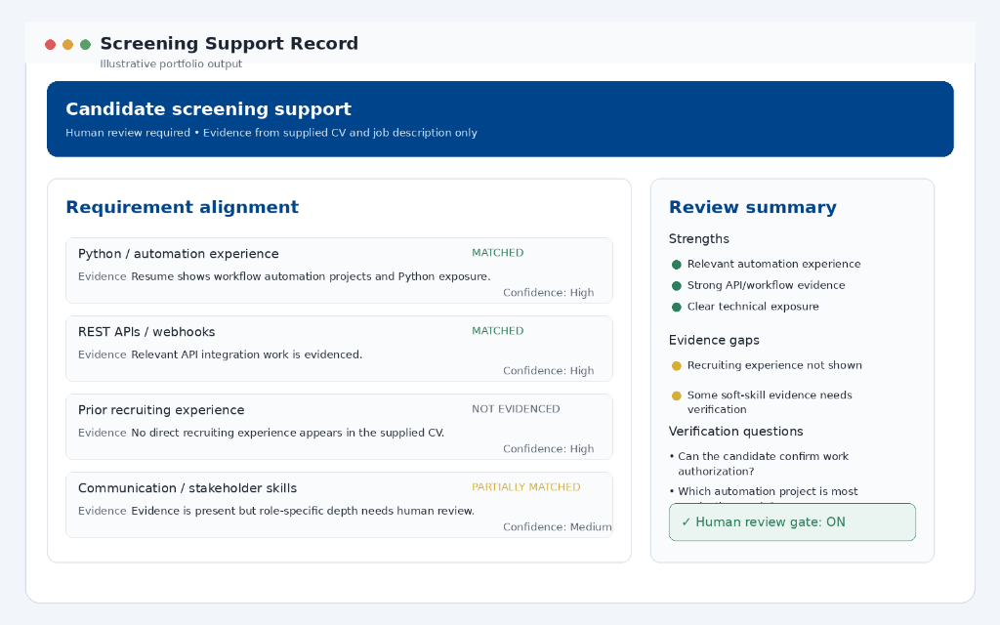

# 👥 Project 04 — AI Candidate Screening Assistant

[](https://n8n.io)
[](https://openai.com)
[](https://drive.google.com)
[](https://notion.so)
[](https://gmail.com)

---

## 📋 Overview

| Field | Details |
|---|---|
| **Industry** | Talent Acquisition / Staffing Agencies / HR Operations / Tech Recruitment |
| **Complexity** | ⭐⭐⭐⭐ Advanced (PDF Extraction + LangChain AI Agent + Structured Output Schema + Multi-Platform Orchestration) |
| **Status** | ✅ Production-ready |
| **Human Review Gate** | **Strictly Enforced** — AI handles evidence extraction and comparative scoring; human recruiters retain 100% authority over final hiring/interview decisions |
| **Time Saved** | **~20 hours/week** per active job requisition |
| **Parsing & Extraction Speed** | Submissions processed and structured in Notion in **< 30 seconds** |
| **Candidate Experience** | Instant, personalized confirmation email dispatched upon application receipt |

---

## 🧩 The Problem

Recruiting and talent acquisition teams face overwhelming application volumes for high-demand roles. Sifting through hundreds of PDF resumes creates severe operational bottlenecks:

1. **Manual Document Sifting is Exhausting & Slow:** Recruiters spend 15–20 minutes per candidate downloading PDFs, reading work histories, hunting for required skills, and copying notes into tracking sheets or Notion.
2. **Unconscious Bias & Inconsistent Screening:** Fatigue leads to subjective skimming, where qualified applicants can be overlooked and unqualified candidates slip through due to unstructured reviews.
3. **Candidate Ghosting:** High submission volume delays initial contact, leaving candidates waiting weeks without even knowing if their application was received.
4. **The "Black Box" AI Risk:** Fully automated rejection bots risk false negatives and legal liabilities. Hiring teams need **evidence-grounded screening assistance**, not automated rejections.

---

## 💡 The Solution

An enterprise-grade **AI Candidate Screening Assistant** that automates the tedious intake, document extraction, evidence mapping, and notification steps — while strictly preserving human recruiter authority for all hiring decisions.

> **Portfolio Message:** *Automate the repetitive preparation work, not the final hiring decision.*

```
1. CAPTURE                    2. PREPARE                   3. SCREEN                  4. LOG + NOTIFY
┌──────────────────┐         ┌──────────────────────┐     ┌─────────────────────┐    ┌─────────────────────┐
│ Application Form │────────▶│Retrieve Job Spec (GD)│────▶│AI Screening Agent   │───▶│Candidate Confirmation│
│ (n8n Form Trigger│         │ + Extract PDF Text   │     │ (GPT-4.1-mini)      │    │ (Gmail Auto-Reply)  │
└────────┬─────────┘         └──────────────────────┘     └──────────┬──────────┘    └─────────────────────┘
         │                                                           │                          ▲
         ▼                                                           ▼                          │
┌──────────────────┐         ┌──────────────────────┐     ┌─────────────────────┐    ┌──────────┴──────────┐
│ Store Resume PDF │────────▶│ Extract Candidate    │────▶│ Structured JSON     │───▶│ Notion ATS Database │
│  (Google Drive)  │         │ Resume Text (PDF)    │     │ Output Parser       │    │ (Full Audit Dossier)│
└──────────────────┘         └──────────────────────┘     └─────────────────────┘    └─────────────────────┘
```

1. **Intake & Secure Storage:** The candidate submits their details and PDF resume via a clean n8n application form. The PDF is stored in Google Drive with standardized naming (`[Full Name] - CV`).
2. **Automated Dual-PDF Extraction:** The workflow downloads the candidate's resume and the official job description PDF, extracting plain text from both documents.
3. **Evidence-Grounded AI Analysis:** An AI agent powered by **GPT-4.1-mini** performs an objective, side-by-side comparison against explicit job requirements.
4. **Strict Safety Guardrails:** System prompts enforce strict constraints:
   - Extract only verifiable evidence present in the documents.
   - No inference of protected demographic traits (gender, race, age, disability).
   - Missing data is marked as *unknown*, not penalized.
   - Flags specific questions for human recruiters to verify in interviews.
5. **Instant Candidate Communication:** Automatically sends a personalized email confirmation via Gmail acknowledging the application.
6. **Notion ATS Logging:** Populates a comprehensive Notion candidate record complete with direct Drive links, match breakdown, strengths, gaps, risk/reward assessment, and recruiter interview questions.

---

## 🏗️ Architecture & Process Flow

```
┌─────────────────────────────────────────────────────────────────────────────────────────────────┐
│                                       1. CAPTURE PHASE                                          │
│                                                                                                 │
│   ┌─────────────────────────────────┐                 ┌─────────────────────────────────────┐   │
│   │   Capture Candidate Application │────────────────▶│        Store Candidate Resume       │   │
│   │         (n8n Form Trigger)      │                 │          (Google Drive Upload)      │   │
│   └─────────────────────────────────┘                 └──────────────────┬──────────────────┘   │
└──────────────────────────────────────────────────────────────────────────┼──────────────────────┘
                                                                           │
                                                                           ▼
┌─────────────────────────────────────────────────────────────────────────────────────────────────┐
│                                       2. PREPARE PHASE                                          │
│                                                                                                 │
│   ┌─────────────────────────────────┐                 ┌─────────────────────────────────────┐   │
│   │    Download Candidate Resume    │────────────────▶│    Extract Candidate Resume Text    │   │
│   │       (Google Drive Node)       │                 │      (PDF Text Extraction Node)     │   │
│   └─────────────────────────────────┘                 └──────────────────┬──────────────────┘   │
│                                                                          │                      │
│   ┌─────────────────────────────────┐                 ┌──────────────────▼──────────────────┐   │
│   │    Retrieve Job Description     │────────────────▶│     Extract Job Description Text    │   │
│   │       (Google Drive Node)       │                 │      (PDF Text Extraction Node)     │   │
│   └─────────────────────────────────┘                 └──────────────────┬──────────────────┘   │
└──────────────────────────────────────────────────────────────────────────┼──────────────────────┘
                                                                           │
                                                                           ▼
┌─────────────────────────────────────────────────────────────────────────────────────────────────┐
│                                       3. SCREEN PHASE                                           │
│                                                                                                 │
│   ┌─────────────────────────────────┐                 ┌─────────────────────────────────────┐   │
│   │      OpenAI Screening Model     │──[Language Model]──▶│      AI Screening Assistant     │   │
│   │          (GPT-4.1-mini)         │                 │       (@n8n LangChain Agent)        │   │
│   └─────────────────────────────────┘                 └──────────────────┬──────────────────┘   │
│                                                                          │                      │
│   ┌─────────────────────────────────┐                                    │                      │
│   │     Screening Result Schema     │──[Output Parser]───────────────────┘                      │
│   │    (Structured JSON Contract)   │                                                           │
│   └─────────────────────────────────┘                                                           │
└──────────────────────────────────────────────────────────────────────────┬──────────────────────┘
                                                                           │
                                                                           ▼
┌─────────────────────────────────────────────────────────────────────────────────────────────────┐
│                                   4. NOTIFY & LOG PHASE                                         │
│                                                                                                 │
│   ┌─────────────────────────────────┐                 ┌─────────────────────────────────────┐   │
│   │  Send Application Confirmation  │────────────────▶│        Log Screening Result         │   │
│   │          (Gmail Node)           │                 │           (Notion Database)         │   │
│   └─────────────────────────────────┘                 └─────────────────────────────────────┘   │
└─────────────────────────────────────────────────────────────────────────────────────────────────┘
```

---

## 🖼️ Process Flow & Visual Architecture

### 🛠️ n8n Workflow Canvas Overview


> *Full visual orchestration in the n8n canvas: 1. Capture Application (Form Trigger + Drive Storage) → 2. Prepare Screening Data (Dual PDF Extraction) → 3. AI Screening Support (LangChain Agent + GPT-4.1-mini + Structured Output Parser) → 4. Notify + Log Results (Gmail Candidate Confirmation + Notion ATS Database Record).*

---

### ⚡ Complete End-to-End Pipeline


> *4-stage modular pipeline: (1) Application Intake & Secure Storage → (2) Dual-Document Text Extraction → (3) Objective AI Screening Agent with Structured Output Schema → (4) Instant Candidate Confirmation & Notion ATS Logging.*

---

### 🔄 What This Automation Changes (Before vs. After)


> *Eliminates manual file downloading, manual text comparison, and data entry. Replaces hours of tedious prep work with a verified, structured dossier ready for human recruiter review.*

---

### 📊 Screening Support Record (Notion Output Preview)


> *Live structured dossier generated for hiring managers: granular requirement alignment badges (`MATCHED`, `PARTIALLY MATCHED`, `NOT EVIDENCED`), confidence levels, strengths, gaps, and human verification interview prompts.*

---

## ✨ Key Features

| Feature | Description |
|---|---|
| 📝 **Hosted Candidate Intake Form** | Collects candidate name, email, phone number, and accepts direct PDF resume uploads |
| 📁 **Automated Drive Organization** | Automatically renames and files resumes into dedicated Google Drive hiring folders |
| 📄 **Dual-Document PDF Parsing** | Extracts clean plain text from both candidate CVs and official job descriptions |
| 🧠 **GPT-4.1-mini AI Screening Agent** | Evaluates candidate credentials strictly against explicit job criteria with quoted evidence |
| 🛡️ **Zero-Bias & Anti-Hallucination Guardrails** | Prohibits inference on demographic traits; treats missing details as unknown rather than penalized |
| 📐 **Strict JSON Schema Contract** | Returns structured strengths, requirement matches, confidence scores, and recruiter check questions |
| ✉️ **Automated Candidate Acknowledgment** | Sends personalized, professional confirmation emails immediately upon application |
| 🗄️ **Comprehensive Notion ATS Record** | Creates rich applicant pages containing Drive links, scores, risk/reward metrics, and full justification |

---

## 🔄 Workflow Node Breakdown

| Node Name | Node Type | Purpose |
|---|---|---|
| **Capture Candidate Application** | `n8n-nodes-base.formTrigger` | Ingests applicant name, email, phone, and PDF CV |
| **Store Candidate Resume** | `n8n-nodes-base.googleDrive` | Uploads the candidate CV to the configured Google Drive folder |
| **Download Candidate Resume** | `n8n-nodes-base.googleDrive` | Retrieves the stored resume binary for text parsing |
| **Extract Candidate Resume Text** | `n8n-nodes-base.extractFromFile` | Converts the candidate PDF into raw text |
| **Retrieve Job Description** | `n8n-nodes-base.googleDrive` | Downloads the active role specification PDF from Drive |
| **Extract Job Description Text** | `n8n-nodes-base.extractFromFile` | Converts the job description PDF into raw text |
| **AI Screening Assistant** | `@n8n/n8n-nodes-langchain.agent` | Analyzes resume vs. job spec using structured reasoning |
| **OpenAI Screening Model** | `@n8n/n8n-nodes-langchain.lmChatOpenAi` | GPT-4.1-mini model powering the LangChain screening agent |
| **Screening Result Schema** | `@n8n/n8n-nodes-langchain.outputParserStructured` | Guarantees strict JSON output with evidence matching |
| **Send Application Confirmation** | `n8n-nodes-base.gmail` | Dispatches instant acknowledgment email to candidate |
| **Log Screening Result** | `n8n-nodes-base.notion` | Creates structured applicant database record in Notion |

---

## 🛠️ Tools & Integrations

- **n8n** — Orchestration engine running the end-to-end recruitment pipeline
- **OpenAI (GPT-4.1-mini)** — High-precision, cost-effective LLM for evidence extraction and comparative evaluation
- **Google Drive** — Secure cloud storage for applicant resumes and official job descriptions
- **Notion** — Modern applicant tracking system (ATS) database and review hub
- **Gmail (OAuth2)** — Transactional candidate acknowledgment emails

---

## 📦 Files in This Folder

```
04-ai-candidate-screening-assistant/
├── README.md                                          ← You are here
├── workflow/
│   └── ai_candidate_screening_assistant.json          ← Import into n8n
└── screenshots/
    ├── workflow_canvas.png                            ← n8n workflow canvas overview
    ├── workflow_architecture.png                      ← End-to-end workflow architecture
    ├── before_vs_after.png                            ← Operational comparison diagram
    └── screening_support_record.png                   ← Notion screening record output preview
```

---

## ⚙️ Setup & Configuration

Before importing and activating the workflow in n8n, configure the following credentials and placeholder IDs:

### Required Credentials:
1. **OpenAI API Key** (connected to `OpenAI Screening Model`)
2. **Google Drive OAuth2** (connected to Drive nodes)
3. **Gmail OAuth2** (connected to `Send Application Confirmation`)
4. **Notion OAuth2 / Internal Integration Token** (connected to `Log Screening Result`)

### Configuration Placeholders in JSON:

| Placeholder | Node | Description |
|---|---|---|
| `[GOOGLE_DRIVE_FOLDER_ID]` | `Store Candidate Resume` | Target Google Drive folder ID where uploaded CVs are saved |
| `[JOB_DESCRIPTION_FILE_ID]` | `Retrieve Job Description` | Google Drive file ID of the job description PDF |
| `[NOTION_DATABASE_ID]` | `Log Screening Result` | Target Notion Database ID for candidate tracking |
| `[COMPANY_NAME]` | `Send Application Confirmation` | Your organization or client company name |
| `[RECRUITING_TEAM_NAME]` | `Send Application Confirmation` | Name of your recruiting team or hiring manager |

### Notion Database Schema Setup:
Ensure your target Notion database contains the following properties:
- **Title (Name)**: Candidate Full Name
- **First Name** (`rich_text`)
- **Last Name** (`rich_text`)
- **Email** (`email`)
- **Phone** (`phone_number`)
- **Application Date** (`date`)
- **Resume** (`url`)
- **Strengths** (`rich_text`)
- **Weaknesses** (`rich_text`)
- **Risk Factor** (`rich_text`)
- **Reward Factor** (`rich_text`)
- **Overall Fit** (`number`)
- **Justification** (`rich_text`)

---

## 📈 Measurable Business Impact & ROI

- ⏰ **Time Saved:** Slashes initial screening time from **15–20 minutes down to under 30 seconds** per applicant — saving **20+ hours per week** for high-volume hiring teams.
- 🎯 **Screening Quality & Consistency:** Every applicant is evaluated against identical criteria with verbatim document citations, removing subjective skimming.
- 📉 **Elimination of Candidate Drop-Off:** Immediate confirmation emails assure applicants their submission is received, improving brand perception.
- 🛡️ **100% Ethical AI Compliance:** Preserves human review for all hiring decisions while removing demographic inference from first-pass reviews.

---

## 🎯 Target ICP & Use Cases

- **Recruiting & Talent Acquisition Teams:** Eliminate repetitive CV review and speed up time-to-shortlist for open roles.
- **Internal HR Operations:** Standardize screening notes and maintain a clean, searchable candidate repository in Notion.
- **Staffing & Executive Search Agencies:** Instantly turn messy client submissions into structured, client-ready candidate profiles.

---

## 👨‍💻 Author & Contact

Built with precision by **Blessing Ekpenyong** — AI Automation Specialist  
- 🌐 **Portfolio:** [GitHub Repository](https://github.com/)  
- 💼 **LinkedIn:** [Blessing Ekpenyong](https://www.linkedin.com/in/blessingekpenyong/)  
- 💬 **Open for Opportunities:** AI Automation · Workflow Engineering · Enterprise Agent Architecture
